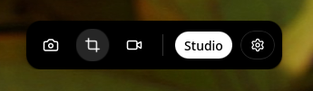

# GlowSnap

  

**A modern open-source screenshot, screen recording, and image editing tool for
Linux**, designed with simplicity, performance, and a beautiful user experience
in mind.

GlowSnap is an open-source screenshot and visual editing application built
specifically for Linux.

Designed for creators, developers, testers, technical writers, educators, and
everyday Linux users, GlowSnap combines fast screen capture, a beautiful editing
experience, and a native Linux workflow into a single application.

Rather than being "just another screenshot tool," GlowSnap focuses on helping
users create polished visuals without unnecessary complexity or cloud services.

---

## Overview

Most screenshot applications stop after capturing the screen.

GlowSnap continues the workflow.

> Capture your screen. Annotate it. Organize it. Export it. Share it.

All inside one application.

The goal is to make screenshots feel like a complete creative workflow instead
of a simple operating system utility.

---

## Philosophy

GlowSnap follows several core principles.

### Linux First

GlowSnap is built specifically for Linux.

Instead of treating Linux as a secondary platform, the project embraces native
Linux technologies and desktop integration from the beginning: the
`xdg-desktop-portal` interfaces for screen capture, PipeWire/PulseAudio for
audio, `wl-copy`/`xclip` for the clipboard, and native desktop notifications.

### Open Source

Every part of the project is open-source.

Users can inspect the code, contribute improvements, suggest features, or build
their own versions. Transparency is one of the project's core values.

### Privacy First

GlowSnap does not rely on cloud services.

Your screenshots remain on your computer.

No account. No tracking. No analytics. No uploads. Your data belongs to you.

### Beautiful by Default

Screenshots are often shared with other people.

GlowSnap focuses on making screenshots look clean and professional with minimal
effort. Instead of requiring multiple editing applications, it provides the
essential tools directly after capture.

---

## Why GlowSnap?

Linux has many excellent screenshot utilities.

GlowSnap does not try to replace them simply by adding another capture button.

Instead, it focuses on the complete experience **after** the screenshot is
taken. It combines capture, editing, organization, and presentation inside a
single workflow.

Whether you're documenting software, creating tutorials, writing documentation,
reporting bugs, or publishing content online, GlowSnap helps transform raw
screenshots into polished assets.

---

## Documentation

| Guide | What it covers |
| ----- | -------------- |
| [Getting started](./getting-started.md) | Installation, the Palette, your first capture |
| [Features](./features.md) | The four pillars: Studio, Editor, Gallery, Recording |
| [Screenshot Studio](./studio.md) | Browsing, searching, favouriting and organising captures |
| [Visual Editor](./editor.md) | Annotation tools, text, crop, background, export |
| [Screen recording](./recording.md) | Audio sources, resolution, pause/stop, playback |
| [Settings reference](./settings.md) | Every option in the Preferences panel |
| [Keyboard shortcuts](./shortcuts.md) | The complete default shortcut list and how to rebind |
| [Troubleshooting](./troubleshooting.md) | Portal errors, missing audio, clipboard, Wayland |
| [Roadmap](./roadmap.md) | What is planned for 1.0 and beyond |
| [Open source & license](./open-source.md) | Contributing, licence, project links |

---

## Use Cases

### Developers

- Documentation
- GitHub issues
- Pull requests
- Tutorials
- Code snippets
- UI previews

### Content Creators

- Social media graphics
- Blog posts
- YouTube thumbnails
- Technical videos

### Designers

- UI reviews
- Feedback
- Mockups
- Visual notes

### Testers

- Bug reports
- QA documentation
- Reproduction steps

### Educators

- Course material
- Slides
- Technical lessons
- Visual explanations

---

## Built With

- **Backend** — Go, native Linux APIs, D-Bus, `xdg-desktop-portal`
- **Desktop framework** — Wails
- **Frontend** — React, TypeScript
- **Styling** — Tailwind CSS, shadcn/ui
- **Editor** — Konva

---

## License

GlowSnap is released under the MIT License.

You are free to use, study, modify and distribute the software according to the
license terms. See [Open source & license](./open-source.md).

---

## Vision

GlowSnap is more than a screenshot application.

It represents the first step toward a larger ecosystem of beautiful,
privacy-respecting, open-source productivity software for Linux.

As part of the LibreGlow ecosystem, GlowSnap demonstrates the organization's
philosophy:

- Open source by default.
- Linux first.
- Privacy first.
- Beautiful user experience.
- Community driven.

The long-term goal is to build software that Linux users genuinely enjoy using
every day.
