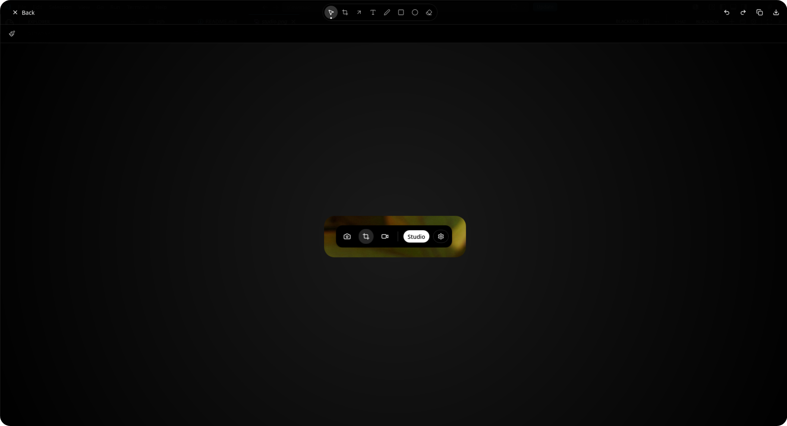

# Features

GlowSnap is built around four pillars. Each one is a complete, self-contained
workflow, and they all share the same data: your captures stay in your own
folders and flow straight from capture into editing.

  

---

## Screenshot Studio

Capture screenshots quickly using multiple modes.

- **Full screen capture** — grabs the entire screen without any extra UI.
- **Area selection capture** — drag a rectangle over the region you want, with
  live size feedback and the ability to move or resize the selection before
  you confirm it.
- **Multi-monitor support** — the area selection overlay goes fullscreen on the
  monitor the GlowSnap window is on, so you can capture any region of it.
- **Capture delay** — wait 0–60 seconds before the capture fires, useful for
  menus and animations you need to trigger yourself.
- **Cursor control** — include or hide the mouse pointer.
- **Hidden panel** — the GlowSnap window hides itself for a moment before the
  capture so it never ends up inside your own screenshot.
- **Post-capture actions** — copy to clipboard, open in your image viewer, or
  show a desktop notification with a preview of the capture.
- **Filename patterns** — choose how files are named, with a `{date}`
  placeholder for a timestamp.

---

## Visual Editor

GlowSnap includes a built-in editor designed specifically for screenshot
annotation.

  

Available tools include:

- **Free drawing** (Pen) with a configurable stroke width
- **Arrows**
- **Rectangles** and **Circles** (outline or filled)
- **Text editing** with font family, size, weight, style, alignment, line
  height and letter spacing
- **Crop tool** with an apply/cancel workflow
- **Eraser**
- **Select & transform** — move, rotate, resize any shape
- **Custom colors**, **opacity controls**, and optional shape fill
- **Background** — linear or radial gradient with start/end color, angle and
  padding, for polished "device mockup" style images
- **Undo / redo** history
- **Zoom & pan** the canvas
- **Copy shape**, **Duplicate shape**, **Delete**, **Deselect**
- **Export** to PNG and **Copy image** to the clipboard

The editor is designed to remain lightweight while providing everything needed
for technical documentation and tutorials.

---

## Screenshot Gallery

Every screenshot is organized automatically.

Instead of manually browsing filesystem folders, GlowSnap provides an integrated
gallery where screenshots can be viewed, searched, and reopened for editing.

- Search by file name
- Sort by newest, oldest, name A–Z or name Z–A
- Star captures as favourites and filter to favourites only
- Rename and delete captures in place
- Reopen any capture in the editor with a single click
- Date, time and file size on every card, and pagination for large folders

---

## Recording

Screen recording is supported through the `xdg-desktop-portal` ScreenCast
interface.

- Full screen recording
- Area selection for record (through the portal's own source picker)
- Microphone capture, with a picker for the active device
- System audio capture (the monitor of your default output device)
- Live toggles for microphone and system audio while recording
- Pause and resume
- Output resolution presets from 360p up to 4K, plus a custom size
- MP4 (H.264 + AAC) output
- A recording gallery with automatic thumbnails and in-app playback

See [Screen recording](./recording.md) for the details.
